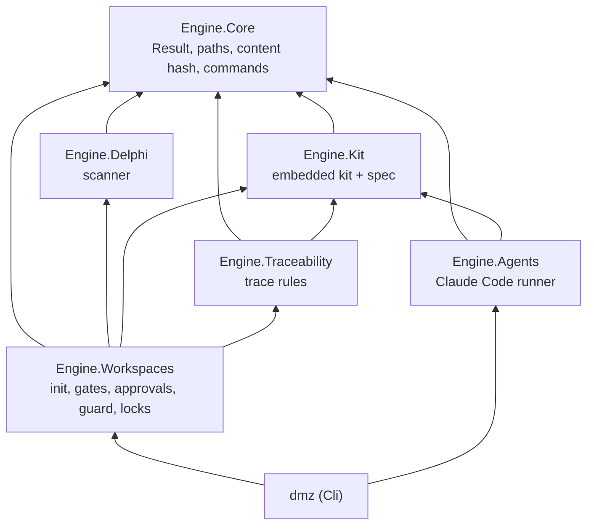

# Engine architecture

The engine is seven .NET 10 projects with one dependency direction. Each layer references only the ones below it;
`tests/DelphiModernizer.ArchitectureTests` fails the build otherwise.

| Project | Responsibility | Never does |
| --- | --- | --- |
| Engine.Core | `Result`/`Error`, workspace-relative paths and containment, the gate content hash, running short commands | know about Delphi, the kit or workspaces |
| Engine.Delphi | Turn a legacy tree into a `LegacyInventory` ([SCANNER.md](SCANNER.md)) | interpret business meaning |
| Engine.Kit | Embed the kit submodule at build time and parse `spec/` | hardcode a spec value |
| Engine.Traceability | Check documents against the kit's trace rules ([TRACEABILITY.md](TRACEABILITY.md)) | change a document |
| Engine.Workspaces | Create workspaces, decide the stack, evaluate gates, record approvals, guard agents, lease deliverables | run an agent |
| Engine.Agents | Run a recipe through the Claude Code CLI and stream typed events ([AGENTS-RUNTIME.md](AGENTS-RUNTIME.md)) | decide or approve anything |
| Cli (`dmz`) | Expose all of it as commands ([CLI.md](CLI.md)) | hold logic the studio would need |

The studio references the same libraries, so a command and its studio counterpart run the same code.

## The kit inside the engine

`kit/` is a git submodule of [delphi-modernizer/kit](https://github.com/delphi-modernizer/kit) pinned to one commit
([ADR 0002](adr/0002-the-kit-is-a-submodule-embedded-at-build.md)). `Engine.Kit` embeds `VERSION`, `spec/`,
`workspace/` and `targets/` as resources; `KitBundle.Embedded` reads them once. A workspace records the kit version it
was created from, and `Workspace.Open` refuses one made by a newer major kit.

## Persisted contracts

Renaming a property in any of these breaks existing workspaces or the studio:

| File | Type | Defined by |
| --- | --- | --- |
| `modernizer.json` | `WorkspaceManifest` | kit `spec/workspace.schema.json` |
| `.modernizer/approvals.json` | `ApprovalLog` | kit `spec/approvals.schema.json` |
| `.modernizer/scans/latest/inventory.json` | `LegacyInventory` | this engine; `SchemaVersion` |
| `.modernizer/runs/<id>.json` | `RunSummary` | this engine |
| `dmz trace --json`, `dmz status --json` | `TraceReport`, `GateStatus[]` | this engine |

An approval or revocation with a commit records `.modernizer/approvals.json` alone, with the subject
`chore: approve the <name> sign-off` or `chore: revoke the <name> sign-off` and a `Gate: <id>` trailer; `<name>` comes
from the kit's `gates.json`. Tools find approval commits by the trailer.

All JSON goes through source-generated `JsonSerializerContext`s: no reflection, camelCase names.
